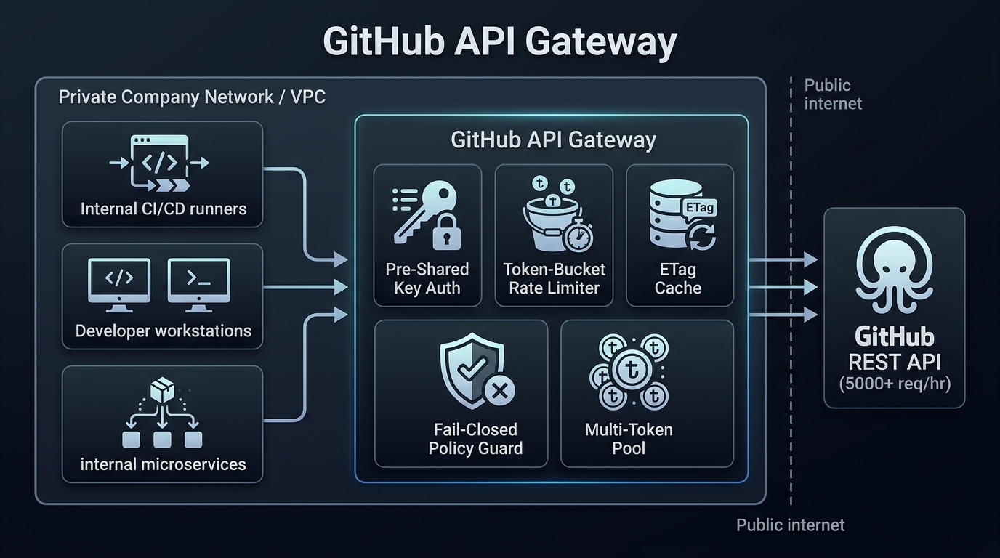

# GitHub API Gateway

[](https://go.dev)
[](https://pkg.go.dev/std)
[-brightgreen)](https://github.com)
[](policy.yaml)

An enterprise-grade reverse proxy and micro-gateway designed to eliminate unauthenticated GitHub API rate limits (60 req/hr) by pooling internal tokens, enforcing fail-closed enterprise access policies, accelerating repeat queries via zero-quota ETag `304 Not Modified` revalidation, streaming S3 binary assets, and protecting against noisy-neighbor quota exhaustion.



---

> [!WARNING]
> ### FOR INTERNAL COMPANY / DEPARTMENT USE ONLY
> **DO NOT EXPOSE THIS GATEWAY TO THE OPEN PUBLIC INTERNET.**
>
> This gateway is engineered strictly to operate within a **private company network, internal VPC, firewalled CI/CD runner subnet, or department cluster**. 
>
> Because the gateway transparently injects company-owned GitHub Personal Access Tokens and grants elevated quota (5,000+ req/hr), exposing its port to the public internet will allow unauthorized external actors to consume your company's API quota, trigger GitHub rate limits, or probe your access boundaries.
>
> Always place this service behind internal firewalls, private load balancers, or VPNs.

---

## The Problem & The Solution

| The Challenge | How GitHub API Gateway Solves It |
| :--- | :--- |
| **Unauthenticated Rate Limit Wall**<br>GitHub limits unauthenticated IPs to **60 req/hr**, breaking shared CI/CD runners and dev teams. | **Intelligent Multi-Token Pool**<br>Aggregates multiple company tokens into a single pool (5,000+ req/hr each), dynamically selecting the token with the **Largest Remaining Quota**. |
| **Data Exfiltration & Security Risks**<br>Open proxies allow developers or CI scripts to touch arbitrary third-party repositories or leak secrets. | **Fail-Closed Enterprise Access Policy**<br>Default Deny (`403 Forbidden`) enforced via YAML (`policy.yaml`). Endpoints like `/user/**`, `/admin/**`, and `/authorizations/**` are hard-blocked. |
| **Quota Depletion on Redundant Calls**<br>CI pipelines repeatedly query unchanged release metadata, draining valuable quota. | **Zero-Quota ETag In-Memory Caching**<br>Caches responses in RAM and sends `If-None-Match`. When GitHub responds with `304 Not Modified`, **zero quota is consumed**. |
| **Large Binary Asset Downloads**<br>Downloading multi-gigabyte tarballs through a proxy exhausts memory and buffers bandwidth. | **Direct S3 CDN Redirect Forwarding**<br>GitHub release asset downloads respond with `302 Found` to AWS S3 (`objects.github...`). The gateway preserves redirects, offloading binary bandwidth. |
| **Noisy Neighbor / Rogue Client Flooding**<br>A runaway loop from one team or test script can drain the entire token pool. | **Per-Client Token-Bucket Rate Limiter**<br>Enforces per-client limits (default: 60 req/min, burst: 10). Flooding clients receive `429 Too Many Requests` without exhausting the shared pool. |
| **Configuration Downtime**<br>Updating access policies or rotating compromised keys requires killing running services. | **Zero-Restart Hot-Reloading**<br>Trigger in-memory reload via `POST /_gateway/reload` or `SIGHUP`. Invalid YAML syntax atomically rolls back with zero dropped connections. |

---

## Architecture Overview

The gateway processes all requests through an ordered, high-performance middleware pipeline:

**Internal Client** ➔ **Auth Manager** ➔ **Rate Limiter** ➔ **ETag Cache** ➔ **Policy Evaluator** ➔ **Token Pool** ➔ **GitHub API**


<details>
<summary><b>View Mermaid Source Code</b></summary>

```text
flowchart LR
    Client["Internal Client<br/>(CI / Dev / Service)"]
    
    subgraph Gateway ["GitHub API Gateway (Go Standard Library)"]
        Auth["1. Auth Manager<br/>(X-Gateway-Key)"]
        RL["2. Rate Limiter<br/>(60 RPM / 10 Burst)"]
        Cache["3. ETag Cache<br/>(0-Quota 304 Reval)"]
        Policy["4. Policy Evaluator<br/>(Fail-Closed Default Deny)"]
        Proxy["5. Reverse Proxy<br/>(Token Injection)"]
    end

    Upstream["GitHub API<br/>api.github.com<br/>(5000+ req/hr)"]

    Client -->|Request + Key| Auth
    Auth -->|Valid| RL
    RL -->|Under Limit| Cache
    Cache -->|Cache Miss or Reval| Policy
    Policy -->|Approved| Proxy
    Proxy -->|Injected Token| Upstream
```

</details>

> [!NOTE]
> For detailed UML sequence diagrams, state machines, and class structures, see [**`docs/architecture.md`**](docs/architecture.md).

---

## Quickstart

### 1. Configure Secrets Locally

Copy the example environment file:
```bash
cp .env.example .env
```

Add your company or personal GitHub tokens in `.env` (separated by commas). You only need this one line:
```bash
GITHUB_API_GATEWAY_TOKENS=ghp_tokenAlpha,ghp_tokenBeta
```
*(Your `.env` file is listed in `.gitignore` and will never be committed to git).*

---

### 2. Run with Native Binary

```bash
# Build the binary
go build -o bin/gateway ./cmd/gateway

# Run the gateway
./bin/gateway -port 8080
```

---

### 3. Run with Docker Compose

```bash
docker compose up -d
```

Verify that the gateway is healthy:
```bash
curl -s http://localhost:8080/_gateway/status | jq .
```

---

## Configuration Reference

All configuration variables use the canonical `GITHUB_API_GATEWAY_` prefix and can be overridden via CLI flags:

| Environment Variable | CLI Flag | Default | Description |
| :--- | :--- | :---: | :--- |
| `GITHUB_API_GATEWAY_PORT` | `-port` | `8080` | Local port to bind the HTTP server. |
| `GITHUB_API_GATEWAY_TOKENS` | `-tokens` | *empty* | Comma-separated GitHub tokens (`ghp_`, `github_pat_`, etc.). |
| `GITHUB_API_GATEWAY_AUTH_KEYS` | `-auth-keys` | *empty* | Comma-separated pre-shared client keys (enables key protection). |
| `GITHUB_API_GATEWAY_POLICY_PATH` | `-policy` | `policy.yaml` | Path to the enterprise access policy file. |
| `GITHUB_API_GATEWAY_TOKEN_MIN_REMAINING` | `-min-remaining` | `3000` | Quota reserve floor per token (sidelined when remaining < floor). |
| `GITHUB_API_GATEWAY_FALLBACK_UNAUTHENTICATED` | `-fallback` | `true` | When tokens are exhausted, proxy unauthenticated instead of failing. |
| `GITHUB_API_GATEWAY_CACHE_TTL_SECONDS` | `-cache-ttl` | `300` | In-memory ETag response cache time-to-live in seconds. |
| `GITHUB_API_GATEWAY_TARGET_URL` | `-target-url` | `https://api.github.com` | Target upstream URL (change for GitHub Enterprise Server). |
| `GITHUB_API_GATEWAY_CLIENT_MAX_RPM` | `-client-max-rpm` | `60` | Maximum requests per minute per client key/IP ($\le 0$ disables). |
| `GITHUB_API_GATEWAY_CLIENT_BURST` | `-client-burst` | `10` | Token-bucket burst capacity per client. |

---

## Enterprise Access Policy (`policy.yaml`)

The gateway follows **Fail-Closed Default Deny**: every request is blocked with `403 Forbidden` unless matched by an explicit rule.

```yaml
# 1. Internal Company Scope
internal_rules:
  - name: "Internal team releases"
    repo: "my-company/*"
    path:
      - "/repos/my-company/*/releases/**"
      - "/repos/my-company/*/tags"
    methods: ["GET", "HEAD"]

# 2. Approved Open Source Dependencies
external_rules:
  - name: "Approved open source dependencies"
    repo:
      - "golang/*"
      - "kubernetes/*"
      - "hashicorp/*"
    methods: ["GET", "HEAD"]

  # Global release asset download rule
  - name: "Universal release asset downloads"
    path: "/repos/*/*/releases/download/**"
    methods: ["GET", "HEAD"]
```

### Policy Rules
- **Glob vs. Regex Separation**: Rules support either `repo` (glob) OR `repo_regex` (Go regex), and `path` (glob) OR `path_regex` (Go regex). Mutually exclusive per rule.
- **Mandatory Methods**: Every rule must explicitly specify allowed HTTP methods (e.g. `["GET", "HEAD"]`). Misspelled methods prevent server startup.
- **Hardcoded Denylist**: Regardless of policy rules, `/user`, `/user/**`, `/admin/**`, `/authorizations/**`, and `/settings/**` are permanently blocked to prevent credential harvesting.

---

## Operational Commands

### Check Health & Telemetry
```bash
curl -s http://localhost:8080/_gateway/status | jq .
```
Returns uptime, active policy rules, cache size, and token pool health with **masked tokens** (e.g. `ghp_...18WX`).

### Zero-Restart Hot-Reload
Modify `policy.yaml` or change rate limits in `.env`, then reload in-memory without dropping in-flight traffic:
```bash
curl -X POST http://localhost:8080/_gateway/reload
```
*(Or send `pkill -HUP gateway`)*.

---

---

## Development & Task Automation (Ports & Adapters)

This repository follows the **Hexagonal (Ports and Adapters)** architecture for task automation and CI. Application tasks are defined authoritatively in modular domain files under `.mise/tasks/`, keeping the root `mise.toml` strictly for pinning tools (`go`, `act`, `watchexec`).

### Quick Command Reference

```bash
# Quality Gate (Zero-artifact read-only checks: fmt, vet, test with -race)
mise run check-all

# Cross-Platform Static Release Compilation (CGO_ENABLED=0)
mise run build-all               # Compiles all 5 binaries into bin/
mise run build:local             # Current host binary
mise run build:linux-x64         # Linux 64-bit Intel/AMD
mise run build:linux-arm64       # Linux 64-bit ARM
mise run build:darwin-x64        # macOS 64-bit Intel
mise run build:darwin-arm64      # macOS Apple Silicon ARM64
mise run build:windows-x64       # Windows 64-bit (.exe)

# Developer Ergonomics
mise run dev:fmt                 # Auto-format all Go source files (gofmt -s -w)
mise run dev:watch               # Event-driven test watcher via watchexec (0% idle CPU)

# Application Lifecycle
mise run bin:run                 # Run native gateway binary locally
mise run bin:status              # Query telemetry endpoint
mise run bin:reload              # Hot-reload policy without restart

# Containers & Docker Compose
mise run docker:build-debian     # Debian-slim target (default, bash & curl)
mise run docker:build-alpine     # Alpine target (minimal, <10MB, busybox sh)
mise run docker:build-distroless # SOTA Distroless target (zero-trust prod, <2MB base, 0 CVEs)
mise run docker:build            # Build all three container flavors
mise run compose:up              # Start gateway via Docker Compose
mise run compose:down            # Stop Docker Compose
mise run compose:ps              # List running Compose services and status
mise run compose:logs            # Stream container logs
mise run compose:exec            # Interactive shell in Compose gateway service
```

---

### Container Targets & Explicit Tagging

The single multi-stage `Dockerfile` provides three target flavors:

1. **`debian` (`debian:bookworm-slim`) [Default]**: Includes standard GNU coreutils, `bash`, and `curl` for seamless local development, testing, and interactive container debugging.
2. **`alpine` (`alpine:3.20`)**: Traditional minimal container image (<10MB, `ca-certificates`, `tzdata`, BusyBox `/bin/sh`).
3. **`distroless` (`gcr.io/distroless/static-debian12:nonroot`)**: SOTA hardened, zero-trust production container (<2MB base overhead, 0 CVEs, zero package manager, zero shell `/bin/sh`, non-root user).

#### Explicit Tagging Conventions:
- **Local Development**:
  - `github-api-gateway:debian` (with `debian-latest` and `latest`)
  - `github-api-gateway:alpine` (with `alpine-latest`)
  - `github-api-gateway:distroless` (with `distroless-latest`)
- **CI / Test Images**:
  - `...-test:YYYYMMDD-HHMM-sha-<hash>-debian`
  - `...-test:YYYYMMDD-HHMM-sha-<hash>-alpine`
  - `...-test:YYYYMMDD-HHMM-sha-<hash>-distroless`
- **Production Releases**:
  - `...:<version>-debian`
  - `...:<version>-alpine`
  - `...:<version>-distroless`
  - `...:debian-latest` & `...:latest` (points to Debian default)
  - `...:alpine-latest`
  - `...:distroless-latest`

Target selection in `docker-compose.yml` is controlled via `GITHUB_API_GATEWAY_CONTAINER_TARGET` (defaulting to `debian`).

---

### Local CI Simulation via Act (`.act/ci.sh`)

Test the exact GitHub Actions workflow inside local Docker containers on macOS (Apple Silicon) before pushing:

```bash
# Dry-run workflow syntax and step matching
./.act/ci.sh -n

# Run full containerized test matrix (Go 1.25.8 with race detector)
./.act/ci.sh test

# Run container build verification inside runner
./.act/ci.sh container
```

---

## License

Internal corporate use. Developed with Go standard library under the [Project Constitution](.specify/memory/constitution.md).
