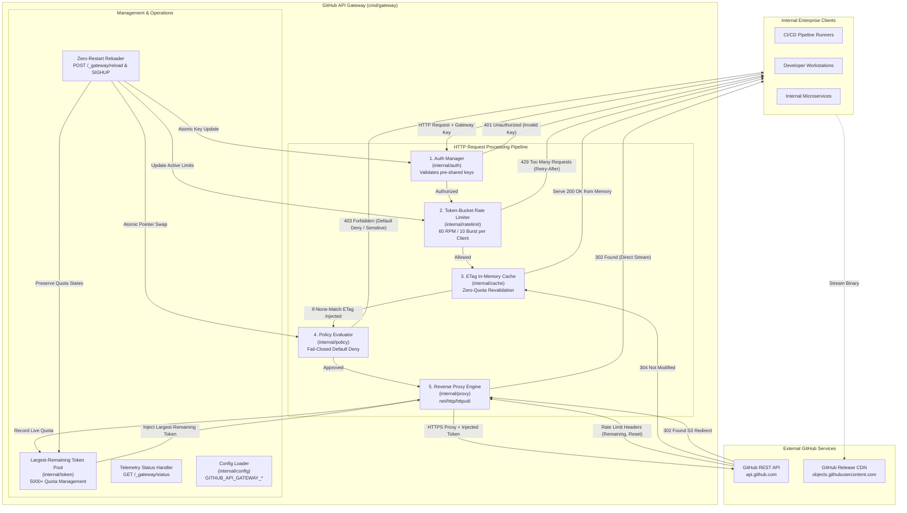
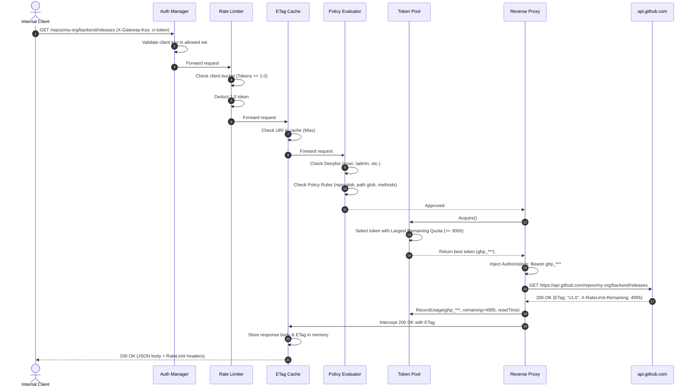
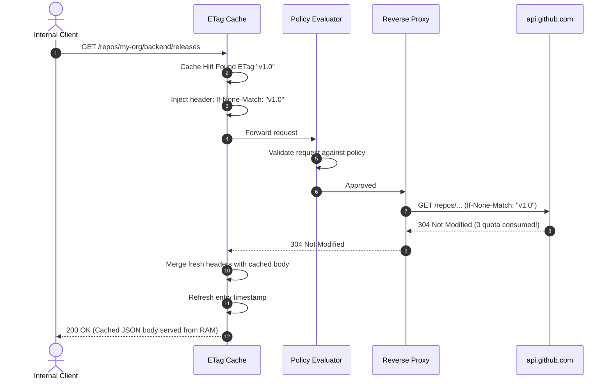
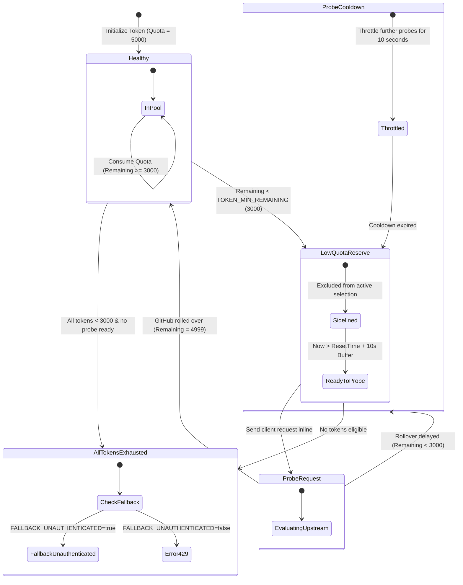
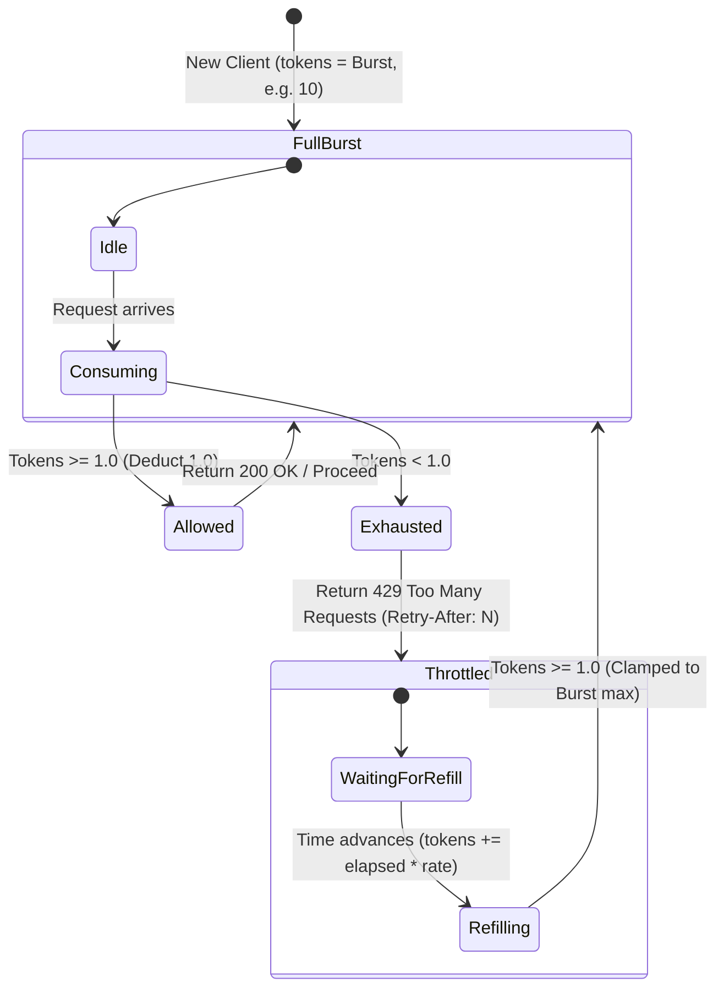
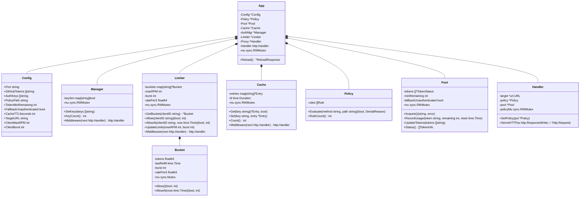

# Architecture & UML Specification: GitHub API Gateway

This document provides technical design specifications and unified modeling language (UML) diagrams for the **GitHub API Gateway**.


---

## 1. System Boundary & Deployment Scope

> [!CAUTION]
> **Internal Private Network Scope Only**
> The GitHub API Gateway is designed strictly for **internal enterprise VPCs, private company subnets, or department clusters**. It transparently injects company-owned GitHub Personal Access Tokens and caches responses in memory.
>
> **NEVER expose this gateway to the public internet.** Exposing it publicly would allow unauthorized external actors to exhaust your pooled GitHub token quota, trigger global IP bans, or abuse the proxy.

```
+--------------------------------------------------------------------------------+
| PRIVATE COMPANY NETWORK / VPC (Firewalled Subnet)                              |
|                                                                                |
|  [ CI/CD Runners ]     [ Dev Workstations ]     [ Internal Microservices ]     |
|          \                      |                      /                       |
|           \                     |                     /                        |
|            +--------------------+--------------------+                         |
|                                 |                                              |
|                                 v                                              |
|                  +------------------------------+                              |
|                  |    GitHub API Gateway        |                              |
|                  |  - Pre-Shared Key Auth       |                              |
|                  |  - Token-Bucket Rate Limiter |                              |
|                  |  - ETag Zero-Quota Cache     |                              |
|                  |  - Fail-Closed Policy Guard  |                              |
|                  |  - Multi-Token Pool          |                              |
|                  |  - Zero-Restart Hot-Reload   |                              |
|                  +--------------+---------------+                              |
+---------------------------------|----------------------------------------------+
                                  | (HTTPS via NAT Gateway / Egress Proxy)
==================================|===============================================
PUBLIC INTERNET                   v
                 +---------------------------------+
                 |  GitHub REST API (api.github.com)|  (5,000+ req/hr per token)
                 +----------------+----------------+
                                  |
                                  | (302 Found Asset Redirect)
                                  v
                 +---------------------------------+
                 |  AWS S3 CDN (objects.github...) |  (Zero bandwidth gateway cost)
                 +---------------------------------+
```

---

## 2. Component Architecture

The gateway is built using pure Go standard library primitives with zero runtime external dependencies (`gopkg.in/yaml.v3` is authorized exclusively for policy parsing).



---

## 3. Sequence Diagrams

### 3.1 Standard Authorized Request & Token Injection



---

### 3.2 Zero-Quota ETag 304 Revalidation



---

### 3.3 S3 Binary Asset Download Redirect

```mermaid
sequenceDiagram
    autonumber
    actor Client as Internal Client
    participant Gateway as GitHub API Gateway
    participant GitHub as api.github.com
    participant S3 as objects.githubusercontent.com

    Client->>Gateway: GET /repos/my-org/app/releases/download/v1.0/bundle.tar.gz
    Gateway->>Gateway: Validate Auth, RateLimit & Policy
    Gateway->>GitHub: GET /repos/my-org/app/releases/download/... (Injected Token)
    GitHub-->>Gateway: 302 Found (Location: https://objects.githubusercontent.com/...)
    Gateway-->>Client: 302 Found (Location: https://objects.githubusercontent.com/...)
    Note over Gateway: Zero memory buffering; large binary not loaded into RAM
    Client->>S3: GET https://objects.githubusercontent.com/...
    S3-->>Client: 200 OK (Stream binary asset directly)
```

---

### 3.4 Zero-Restart Hot-Reloading with Atomic Rollback

```mermaid
sequenceDiagram
    autonumber
    actor Operator as DevOps / SRE
    participant Server as HTTP Server
    participant Reloader as App.Reload()
    participant State as Gateway State (Policy, Pool, Auth, Limiter)

    Operator->>Server: POST /_gateway/reload (or SIGHUP)
    Server->>Reloader: Invoke Reload()
    Reloader->>Reloader: Reload .env & environment variables
    Reloader->>Reloader: Parse & Validate policy.yaml

    alt Invalid YAML Syntax or Misspelled Method
        Reloader->>Reloader: Validation Failed!
        Reloader->>Reloader: Roll back; keep previous state pointers intact
        Reloader-->>Server: Error (validation failed)
        Server-->>Operator: 400 Bad Request ("previous configuration preserved")
    else Valid Configuration
        Reloader->>State: Atomically update Policy rules
        Reloader->>State: Atomically replace allowed Gateway Keys
        Reloader->>State: Update Token Pool (preserves existing quota status)
        Reloader->>State: Dynamically update Rate Limits (UpdateLimits)
        Reloader-->>Server: Success
        Server-->>Operator: 200 OK ({"status":"reloaded", "active_tokens":...})
    end
```

---

## 4. State Machines

### 4.1 Token Pool Lifecycle & Reset Probe Cooldown



---

### 4.2 Per-Client Token-Bucket Rate Limiter



---

## 5. Class & Structural Relationships


